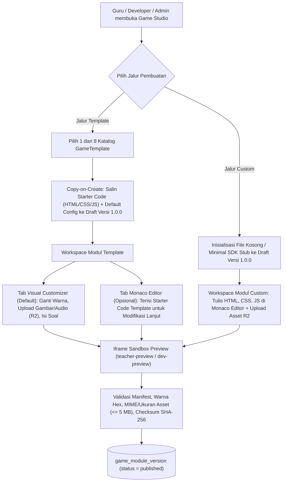
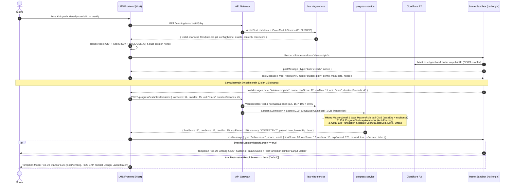

# PRD: Game Module Studio (WordPress-Style Code Template & Custom) — v1.1.0

| Atribut | Detail |
|---|---|
| **Penulis** | Achmad (NIM 2301508) |
| **Judul Skripsi** | Pengembangan Dashboard Management System Berbasis Dynamic Module Injection pada LMS KABIRU |
| **Versi Dokumen** | `1.1.0` (28 Nov 2026) |
| **Branch Target** | `feat/module-game-studio-v1.1.0` |
| **Basis Sebelumnya** | `docs/prd-module-game.md` (`v1.0.0`) |
| **Status** | Spesifikasi Teknis & Arsitektur `v1.1.0` |
| **Layanan Terdampak** | `learning-service`, `progress-service`, `api-gateway`, `@kabiru/contracts`, Frontend CMS & LMS Player |

---

## Ringkasan Perubahan Versi (`v1.0.0` → `v1.1.0`)

Sesuai aturan *Semantic Versioning* (`x.y.z`), perubahan ini diklasifikasikan sebagai **Minor / Feature Release (`1.1.0` — `y + 1, z = 0`)** karena menghadirkan penambahan fitur dan penyesuaian arsitektur signifikan pada `game-module` berdasarkan evaluasi dosen pembimbing, **tanpa merombak ulang (revamp total)** fondasi *microservices*, Monaco Editor, Cloudflare R2, maupun *iframe sandboxing* yang sudah dibangun pada `v1.0.0`.

| Aspek | Kondisi `v1.0.0` | Perubahan pada `v1.1.0` |
|---|---|---|
| **Makna Template** | Form isian teks soal; kode mesin template tersembunyi di filesystem backend dan baru disalin saat `publish`. | **Code Template ala WordPress Theme:** Setiap template memiliki *starter code* (`index.html`, `style.css`, `script.js`) yang langsung dimuat saat draft dibuat, dilengkapi slot tema & media. |
| **Hak Akses Jalur & Monaco Editor** | Role `teacher` (Guru) diblokir dari jalur `custom` & Monaco Editor (`FR-16` & `FR-18`); Monaco hanya untuk `developer`/`admin`. | **Guru & Developer Setara di Studio:** Baik `teacher`, `developer`, maupun `admin` dapat memilih jalur **Template** maupun **Custom** (dengan isolasi kepemilikan `createdBy` & proteksi master katalog `GameTemplate`). **Template:** Monaco langsung terisi *starter code* template terpilih. **Custom:** Monaco terbuka kosong (kerangka minimal SDK). |
| **Kustomisasi Visual & Media** | Hanya mengisi teks pertanyaan & opsi jawaban. | **Visual Customizer ala WordPress:** Pembuat modul dapat mengganti palet **warna**, mengunggah **gambar** (*background*, ilustrasi/sprite), mengunggah **audio** (BGM & SFX), serta mengisi konten soal tanpa wajib menyentuh kode. |
| **Runtime & Preview** | Satu arah `kabiru:init` saat muat ulang iframe; CSP belum mengakomodasi media audio/gambar eksternal. | **One Runtime, Three Modes** (`dev-preview`, `teacher-preview`, `student-play`) di dalam `<iframe sandbox="allow-scripts">` + event `kabiru:config_update` untuk *live preview* warna/audio/gambar instan, serta dukungan CSP + CORS ke Cloudflare R2. |
| **Normalisasi Skor & Pop-Up Hasil** | Hanya menerima angka `score` mentah satu arah (`fire-and-forget`); belum ada kontrak satuan bintang/poin dinamis maupun balasan hasil ke game. | **Normalized Scoring (`rawScore`/`rawMax` → `0..100`) & Two-Way Result (`kabiru:result`):** Mendukung penilaian bintang/poin per soal, mengembalikan hasil resmi server (`finalScore`, `expEarned`, `passed`) via `await Kabiru.complete()`, serta flag `customResultScreen` untuk memilih Pop-Up standar LMS atau Pop-Up kustom di dalam game. |
| **Integrasi Materi, Kuis & EXP** | Kontrak berhenti di batas klaim skor tanpa spesifikasi alur ke Materi, Bank Soal (`Test`), dan Gamifikasi CMS (`progress-service`). | Spesifikasi end-to-end pengikatan `GameModuleVersion` ke `Material`/`Test` dan `Challenge`, perhitungan EXP berbasis `MasteryRule` & `ChallengeTier` dari CMS, serta proteksi *anti-farming* EXP. |

---

## 1. Konsep & Latar Belakang Perubahan

### 1.1 Masalah pada `v1.0.0`
Berdasarkan hasil diskusi bimbingan dan kebutuhan lapangan mata pelajaran Informatika SMP/SMA di KABIRU:
1. Konsep *template* pada `v1.0.0` baru sebatas form teks soal biasa, belum merepresentasikan **Template Code** layaknya ekosistem **WordPress Theme** di mana pengguna dapat menyesuaikan warna, gambar aset, dan audio.
2. Pembatasan `FR-16` pada `v1.0.0` yang melarang Guru memilih jalur `custom` terlalu kaku untuk konteks guru Informatika yang juga mampu menulis atau memodifikasi HTML/CSS/JS di Monaco Editor.
3. Pembuat game yang memakai mekanisme penilaian internal seperti **bintang per soal** (mis. 0–3 bintang × $N$ soal) membutuhkan standarisasi konversi ke skala nilai LMS (`0–100`) sekaligus cara memanggil hasil skor & EXP resmi untuk ditampilkan sebagai *Victory Pop-Up*.
4. Jembatan dari penyelesaian modul game di `<iframe>` menuju materi terkait (`Material`/`Test`), aturan gamifikasi CMS (`MasteryRule`, `Challenge`, `Badge`), serta pencairan EXP (`ExpTransaction`) perlu disatukan dalam satu kontrak yang aman.

### 1.2 Solusi Arsitektur `v1.1.0`

Analogi WordPress dipetakan langsung ke arsitektur **Dynamic Module Injection** LMS KABIRU:

| Komponen WordPress | Padanan pada LMS KABIRU (`v1.1.0`) |
|---|---|
| **WordPress Core** | Host Dashboard Management System & LMS Player |
| **Theme Code Package** | `GameTemplate` (*Starter Code* `index.html`, `style.css`, `script.js` + CSS Variables + Deklarasi Schema) |
| **Theme Customizer & Media Library** | Panel Visual Customizer (Color Picker, Image Uploader, Audio Uploader via `AssetService` & Cloudflare R2) |
| **Theme File Editor / Blank Theme** | Monaco Editor di Game Studio (terisi *template code* untuk jalur `template`, atau kosong/minimal SDK untuk jalur `custom` — dapat diakses `teacher`, `developer`, dan `admin`) |
| **Site Instance & Post Content** | `GameModuleVersion` yang ditautkan ke `Test` (Materi/Kuis) atau `Challenge` |

#### Keputusan Desain Utama & Trade-off

1. **Strategi *Copy-on-Create* untuk Kode Template**
   - **Keputusan:** Saat modul jalur `template` dibuat (`createModule` / `createVersionDraft`), *starter code* (`index.html`, `style.css`, `script.js`) dari `GameTemplate` langsung disalin menjadi berkas draft versi modul tersebut, sementara kustomisasi warna, gambar, audio, dan soal disimpan terpisah di JSON `config`.
   - **Alasan:** Menyatukan struktur penyimpanan antara jalur `template` dan `custom` sehingga perubahan pada codebase `learning-service` sangat minimal. Guru yang tidak ingin coding cukup memakai **Panel Visual Customizer**, sedangkan Guru atau Developer yang ingin memodifikasi kode template tinggal membuka tab **Monaco Editor** pada modul miliknya sendiri tanpa merusak master `GameTemplate`.
   - **Alternatif yang ditolak:** *Live Reference* murni tanpa menyalin kode sampai waktu publish. Ditolak karena membuat pipeline editor bercabang dua dan menyulitkan modifikasi kode per modul (*forking*).

2. **Zero-Trust Sandbox untuk Semua Pembuat Modul (`teacher` & `developer`)**
   - **Keputusan:** Membuka jalur `custom` dan Monaco Editor kepada `teacher`, sambil mengunci eksekusi seluruh modul di dalam `<iframe sandbox="allow-scripts">` (tanpa `allow-same-origin`) + CSP `connect-src 'none'` + isolasi kepemilikan `createdBy`.
   - **Alasan:** Memberikan fleksibilitas penuh kepada guru Informatika tanpa meningkatkan risiko terhadap keamanan sesi/cookie LMS maupun modul milik guru lain.

3. **Server-Authoritative Gamification dengan Two-Way Result Callback**
   - **Keputusan:** Kode di dalam `<iframe>` **dilarang menghitung sendiri** besaran EXP, menentukan kenaikan Level/Badge, atau memanggil API database langsung. Namun, kode game **diizinkan menerima kembali** hasil perhitungan resmi server melalui balasan Promise `await Kabiru.complete(...)` (`kabiru:result`) untuk ditampilkan sebagai Pop-Up di dalam game jika diinginkan.
   - **Alasan:** Mencegah kecurangan manipulasi rumus EXP di sisi klien (*OWASP Client-Side Trust*), menjaga konsistensi aturan gamifikasi yang dikustomisasi di CMS, namun tetap memberi kebebasan penuh bagi pembuat game untuk merancang layar kemenangan (*Victory Pop-Up*) kustom.

---

## 2. Persona & Perilaku Studio per Role (`v1.1.0`)

| Persona | Mode yang Diakses | Pengalaman di Dashboard / LMS (`v1.1.0`) |
|---|---|---|
| **Guru** (`teacher`) | Jalur **Template** & **Custom** *(khusus modul miliknya sendiri)* | **Pilih Template:** Menggunakan **Visual Customizer** (ganti warna, upload gambar & audio, isi soal) dan boleh membuka **Monaco Editor** yang sudah terisi *template code* jika ingin kustomisasi lanjut. **Pilih Custom:** Menulis HTML/CSS/JS dari nol di Monaco Editor + menguji di **Live Preview**. |
| **Developer Modul** (`developer`) | Jalur **Template** & **Custom** + Katalog Template | Sama seperti Guru pada pembuatan modul, ditambah kemampuan membuat/memelihara master *starter code* pada katalog `GameTemplate` serta panel inspeksi log event di **Developer Preview**. |
| **Admin LMS** (`admin`) | Semua Jalur + Manajemen Semua Modul & CMS Gamifikasi | Mengelola seluruh modul lintas pembuat, mengelola katalog `GameTemplate`, menautkan versi modul `published` ke `Test`/`Challenge`, serta mengonfigurasi aturan EXP (`MasteryRule`, `Level`, `ChallengeTier`, `Badge`) di CMS. |
| **Siswa** (`student`) | **LMS Player** (`student-play`) | Memainkan game pada halaman Materi/Kuis atau Tantangan di dalam `<iframe sandbox="allow-scripts">`, melihat Pop-Up skor/bintang & perolehan EXP, lalu melanjutkan ke materi berikutnya. |

---

## 3. User Stories (`v1.1.0`)

| ID | User Story | Prioritas | Status terhadap `v1.0.0` |
|---|---|---|---|
| **US-13** | Sebagai **guru/developer**, saya dapat mengganti skema warna template game (warna utama, latar, permukaan kartu, teks, aksen) melalui *color picker* agar tampilan game sesuai tema materi tanpa harus mengedit CSS manual. | P0 | **Baru (`v1.1.0`)** |
| **US-14** | Sebagai **guru/developer**, saya dapat mengunggah file gambar (latar, ikon, ilustrasi) dan audio (musik latar/BGM, efek suara benar/salah) ke dalam game agar pengalaman bermain siswa lebih kaya. | P0 | **Baru (`v1.1.0`)** |
| **US-15** | Sebagai **guru/developer**, setiap perubahan warna, gambar, audio, atau kode langsung terlihat pada panel **Live Preview** berbasis `iframe` sandbox sebelum dipublikasikan. | P0 | **Diperluas (`v1.1.0`)** |
| **US-16** | Sebagai **guru** atau **developer**, saya dapat memilih jalur **Template** (Monaco Editor langsung terisi *starter code* template terpilih) maupun jalur **Custom** (Monaco Editor terbuka kosong dengan kerangka SDK minimal untuk membuat game bebas dari nol). | P0 | **Revisi `US-01`/`US-02` (`v1.1.0`)** |
| **US-17** | Sebagai **admin/guru**, saya dapat menautkan versi modul game yang sudah `published` ke Kuis pada suatu **Materi** (`Test.gameModuleVersionId`) atau ke **Tantangan** (`Challenge.gameModuleVersionId`). | P0 | **Diperjelas (`v1.1.0`)** |
| **US-18** | Sebagai **siswa**, setelah menyelesaikan game kuis terkait materi, skor saya dinormalisasi dan diverifikasi server untuk mencairkan **EXP**, memperbarui **Streak/Level/Rank**, dan mencatat ketuntasan materi sesuai aturan gamifikasi di CMS. | P0 | **Baru (`v1.1.0`)** |
| **US-20** | Sebagai **pembuat game (guru/developer)**, saya dapat memakai satuan penilaian bebas seperti **bintang per soal** (`rawScore` / `rawMax`) yang otomatis dikonversi ke skala `0–100`, serta memanggil hasil akhir resmi (`await Kabiru.complete()`) untuk ditampilkan sebagai Pop-Up. | P0 | **Baru (`v1.1.0`)** |
| **US-19** | Sebagai **guru/developer**, saya dapat mereset ulang kode modul bertipe `template` (yang masih `draft`) kembali ke *starter code* bawaan template jika modifikasi kode saya di Monaco mengalami error. | P1 | **Baru (`v1.1.0`)** |

---

## 4. Functional & Non-Functional Requirements (`v1.1.0`)

### 4.1 Manajemen Template Code, Monaco Editor, & Hak Akses (Revisi `FR-16` & `FR-18`)
| ID | Requirement | Acceptance Criteria |
|---|---|---|
| **FR-20** | Setiap `GameTemplate` wajib menyimpan *starter code* (`index.html`, `style.css`, `script.js`) serta skema kustomisasi terstruktur (`theme`, `assets`, `gameplay`, `content`). | Pemanggilan detail template mengembalikan `configSchema`, `defaultConfig`, dan `starterFiles`. |
| **FR-20b** | *(Menggantikan `FR-16` & `FR-18` pada `v1.0.0`)* Role `teacher`, `developer`, dan `admin` diizinkan membuat, mengedit di Monaco Editor, menyimpan berkas versi, dan mempublikasikan modul baik pada jalur `template` maupun `custom`. | Guru yang memanggil `createModule(source: "custom")` dan endpoint simpan berkas versi mendapat respons `200`/`201` (bukan `403`). |
| **FR-20c** | Isolasi kepemilikan (`FR-17`) dan proteksi katalog tetap ditegakkan: `teacher` hanya dapat melihat, mengubah, dan mempublikasikan `GameModule` dengan `createdBy = userId` miliknya sendiri, serta tidak dapat mengubah tabel master `GameTemplate`. | Guru A yang mengakses atau menyimpan berkas modul milik Guru B ditolak dengan `403 FORBIDDEN`. |
| **FR-21** | Pembuatan modul dengan `source = "template"` menyalin *starter code* template ke berkas draft versi awal (`1.0.0`), sehingga endpoint detail versi langsung mengembalikan isi `index.html`, `style.css`, dan `script.js` untuk dimuat di Monaco Editor maupun preview. | `GET` detail versi draft template mengembalikan 3 file entrypoint dengan `content` sesuai template terpilih. |
| **FR-22** | Pembuatan modul dengan `source = "custom"` menginisialisasi `index.html`, `style.css`, dan `script.js` dalam keadaan kosong (hanya kerangka komentar/pemanggilan minimal `window.Kabiru.onInit` ≤ 15 baris), tanpa kode dari template mana pun. | Monaco Editor pada mode `custom` terbuka bersih siap ditulis dari awal. |
| **FR-23** | Kode CSS pada seluruh 8 template bawaan wajib menggunakan CSS Custom Properties (`--kabiru-primary`, `--kabiru-bg`, `--kabiru-surface`, `--kabiru-text`, `--kabiru-accent`) agar perubahan warna dari Customizer diterapkan tanpa perlu menulis ulang file CSS. | Mengubah nilai hex warna pada `config.theme` otomatis mengubah tampilan warna elemen di dalam iframe. |

### 4.2 Kustomisasi Warna, Gambar, & Audio (Media Assets)
| ID | Requirement | Acceptance Criteria |
|---|---|---|
| **FR-24** | Guru dan developer dapat mengunggah aset gambar dan audio melalui `AssetService` ke Cloudflare R2 dan menautkan `assetId`-nya ke slot `config.assets` (untuk jalur `template`) atau ke berkas versi `GameModuleFile` (untuk jalur `custom`). | File tersimpan di R2, tercatat di tabel `asset` (`kind = image \| audio`), dan memiliki `publicUrl` HTTPS. |
| **FR-25** | Validasi ketat tipe dan ukuran file aset: Gambar (`image/png`, `image/jpeg`, `image/webp`, maks **2 MB**/file) dan Audio (`audio/mpeg`, `audio/ogg`, `audio/wav`, maks **3 MB**/file), dengan batas total seluruh berkas per versi modul tetap **5 MB** (`MAX_MODULE_VERSION_BYTES`). File `.svg` ditolak pada upload aset untuk mencegah *Stored XSS* via script di dalam SVG. | Upload file di luar whitelist MIME, *magic bytes* tidak cocok, atau melebihi kuota ditolak dengan HTTP `400` / `413`. |
| **FR-26** | Setiap slot aset pada template memiliki fallback aman sehingga game tetap berjalan normal meskipun pengguna tidak mengunggah gambar atau audio sendiri. | Jika `config.assets.bgmAudio` bernilai `null`, game tetap berjalan tanpa *unhandled error*. |
| **FR-27** | Semua nilai warna pada `config.theme` wajib divalidasi di server menggunakan format warna Hex aman (`^#([0-9A-Fa-f]{6}|[0-9A-Fa-f]{3})$`). | Input injeksi CSS seperti `#fff; background:url(...)` ditolak validator Zod dengan HTTP `400`. |

### 4.3 Sandboxed Runtime, Normalisasi Skor Bintang, & Pop-Up Hasil
| ID | Requirement | Acceptance Criteria |
|---|---|---|
| **FR-28** | Komponen pemutar game menggunakan satu pipeline `<iframe sandbox="allow-scripts">` yang sama untuk 3 mode: `dev-preview`, `teacher-preview`, dan `student-play` (tanpa `allow-same-origin`). | Akses `window.parent.document` dan `document.cookie` dari dalam iframe selalu gagal di ketiga mode. |
| **FR-29** | Pada mode `teacher-preview` dan `dev-preview`, perubahan konfigurasi warna/aset dikirimkan via `kabiru:config_update` ke iframe aktif untuk pembaruan instan (*hot update*), disertai tombol *Restart Preview* bila kode JS/HTML berubah. | Perubahan warna di *color picker* langsung tercermin di iframe dalam < 200 ms. |
| **FR-30** | Pada mode `dev-preview` dan `teacher-preview`, penyelesaian game (`kabiru:complete`) tidak menyentuh database `progress-service`, melainkan dibalas langsung oleh Host dengan hasil simulasi lokal (`isPreview: true`, `expEarned: 0`) agar Pop-Up hasil tetap dapat diuji. | Menyelesaikan game di mode preview menampilkan Pop-Up hasil dengan benar dan menambah `0` EXP di database. |
| **FR-35** | **Normalisasi Skor Satuan Bebas (`rawScore` / `rawMax`):** Kontrak penyelesaian game mendukung pengiriman `rawScore` dan `rawMax` (dengan `rawMax > 0` dan `0 <= rawScore <= rawMax`, mis. sistem bintang per soal). Backend menormalisasi nilai ke skala `max_score` (`100`) dengan rumus $\text{round}((\text{rawScore} / \text{rawMax}) \times \text{maxScore}, 2)$ untuk disimpan pada `Score.finalScore` (`Decimal(5,2)`), sementara data mentah bintang disimpan di JSONB `Submission.answer`. | Siswa yang meraih `12` dari `15` bintang pada modul ber-`max_score: 100` tercatat memperoleh `finalScore = 80.00` dan detail `12/15 stars` tersimpan di `Submission.answer`. |
| **FR-36** | **Komunikasi Dua Arah Pop-Up Hasil (`kabiru:result` & `customResultScreen`):** Setelah Host memproses `kabiru:complete` ke server, Host mengirimkan pesan balasan `kabiru:result` berisi `{ finalScore, rawScore, rawMax, expEarned, mastery, passed, leveledUp, isPreview }` ke iframe sehingga pemanggilan `await Kabiru.complete(...)` di kode game ter-*resolve*. Jika `manifest.customResultScreen = false` *(default)*, Host menampilkan Modal Pop-Up hasil standar LMS; jika `true`, Host menyerahkan tampilan Pop-Up hasil ke dalam iframe game dan hanya menyediakan kontrol navigasi materi di luar iframe (mencegah dobel pop-up). | Game dengan `customResultScreen: true` hanya menampilkan Pop-Up buatannya sendiri berisi skor & EXP resmi dari server tanpa tertimpa modal kedua dari Host. |

### 4.4 Integrasi Materi, Kuis, & Gamifikasi CMS (EXP)
| ID | Requirement | Acceptance Criteria |
|---|---|---|
| **FR-31** | Versi modul `published` dapat ditautkan ke entitas `Test` (terkait `Material` melalui `Test.materialId`) maupun ke entitas `Challenge` (`Challenge.gameModuleVersionId`). | Membuka kuis pada suatu Materi memuat `GameModuleVersion` yang ditautkan pada `Test`. |
| **FR-32** | Saat siswa menyelesaikan game pada konteks `Test`, Host mengirim hasil permainan ke backend untuk dicatat pada `Submission` dan `Score`, memperbarui `ProgressTest`, serta menentukan `MasteryLevel`. | Record `submission`, `score`, dan `progress_test` tersimpan secara atomik. |
| **FR-33** | Besaran perolehan EXP dihitung secara *server-authoritative* di `progress-service` mengacu pada konfigurasi gamifikasi CMS (`MasteryRule`: `baseExp`, `expBonus`, `rankPoint`; atau `ChallengeTier.rewardExp`), dicatat pada `ExpTransaction` (`sourceType = QUIZ \| CHALLENGE`), serta memperbarui `UserStat.totalExp`, `Level`, `DailyActivity`, dan `Streak`. | Mengubah nilai `baseExp` di CMS Gamifikasi otomatis mengubah perolehan EXP tanpa mempublikasikan ulang modul game. |
| **FR-34** | Proteksi *Idempotency* & *Anti-Farming* EXP: pencairan EXP kuis hanya diberikan saat syarat ketuntasan pertama tercapai (`ProgressTest.expAwardedAt IS NULL`) atau peningkatan `MasteryLevel`, sehingga pengulangan kuis yang sama tidak menggandakan EXP. | Submit ulang pada kuis yang sudah tuntas dengan penguasaan sama menghasilkan `expEarned = 0` tanpa duplikasi `ExpTransaction`. |

---

## 5. Arsitektur & Alur Data

### 5.1 Alur Pembuatan Modul di Game Studio (`v1.1.0`)



### 5.2 Alur Eksekusi Siswa, Normalisasi Skor Bintang, Pop-Up Hasil, & EXP



### 5.3 Kebijakan Keamanan `iframe`, CSP, dan CORS Media (`v1.1.0`)

Karena `<iframe sandbox="allow-scripts">` tidak memakai `allow-same-origin`, origin iframe bernilai `"null"`. Agar gambar dan audio di Cloudflare R2 tetap dapat dimuat dengan aman tanpa membuka akses jaringan bebas:

1. **Content Security Policy (CSP) di dalam `srcdoc`:**
   ```http
   default-src 'none';
   script-src 'unsafe-inline';
   style-src 'unsafe-inline';
   img-src data: blob: https://*.r2.dev https://<DOMAIN_ASSET_R2_KABIRU>;
   media-src data: blob: https://*.r2.dev https://<DOMAIN_ASSET_R2_KABIRU>;
   font-src data: https://fonts.gstatic.com;
   connect-src 'none';
   ```
2. **Konfigurasi CORS pada Bucket Cloudflare R2:**
   - `AllowedOrigins`: `["*"]` (wajib karena request aset dari iframe sandbox ber-origin `null`)
   - `AllowedMethods`: `["GET", "HEAD"]`
   - `AllowedHeaders`: `["Range", "Content-Type"]`

---

## 6. Kontrak Modul, Konfigurasi, & SDK (`v1.1.0`)

### 6.1 Skema `manifest` Modul (`v1.1.0`)
```json
{
  "schema_version": 1,
  "name": "Kuis Bintang Algoritma",
  "slug": "kuis-bintang-algoritma",
  "version": "1.1.0",
  "source": "custom",
  "template_id": null,
  "entry": {
    "html": "index.html",
    "css": "style.css",
    "js": "script.js"
  },
  "max_score": 100,
  "custom_result_screen": true,
  "config_schema": {
    "type": "object",
    "properties": {}
  }
}
```
- `custom_result_screen` (`boolean`, opsional, default `false`): menentukan apakah layar/pop-up hasil akhir dirender sendiri oleh kode di dalam game (`true`) atau menggunakan Modal Pop-Up bawaan Host LMS (`false`).

### 6.2 Struktur Standar `config` pada `GameModuleVersion`
Objek `config` distandarisasi menjadi 4 namespace (dengan fallback kompatibilitas mundur `config.content ?? config` untuk modul `v1.0.0`):

```json
{
  "theme": {
    "primaryColor": "#0284C7",
    "backgroundColor": "#F8FAFC",
    "surfaceColor": "#FFFFFF",
    "textColor": "#0F172A",
    "accentColor": "#16A34A"
  },
  "assets": {
    "backgroundImage": {
      "assetId": "a3f1c9e0-1234-4b56-89ab-cdef01234567",
      "url": "https://cdn.kabiru.id/lms/game-assets/sha256-bg-hutan.webp"
    },
    "bgmAudio": {
      "assetId": "b7d2e8f1-2345-4c67-89ab-cdef01234568",
      "url": "https://cdn.kabiru.id/lms/game-assets/sha256-ceria.mp3"
    },
    "correctSfx": {
      "assetId": "c9e3f7a2-3456-4d78-89ab-cdef01234569",
      "url": "https://cdn.kabiru.id/lms/game-assets/sha256-benar.mp3"
    },
    "wrongSfx": null
  },
  "gameplay": {
    "timeLimitSeconds": 60,
    "bgmVolume": 0.5,
    "shuffleOptions": true
  },
  "content": {
    "question": "Struktur data manakah yang bekerja dengan prinsip LIFO?",
    "options": ["Queue", "Stack", "Tree", "Graph"],
    "answerIndex": 1,
    "explanation": "Stack menumpuk elemen sehingga elemen terakhir yang masuk keluar lebih dulu."
  }
}
```

### 6.3 Protokol `postMessage` & Normalisasi Skor (`v1.1.0`)

| Arah | `type` | Payload | Keterangan |
|---|---|---|---|
| Host → Game | `kabiru:init` | `{ mode, config, maxScore, attemptId, nonce }` | Dikirim setelah `kabiru:ready`. SDK otomatis menyuntikkan `config.theme` ke CSS Variables `:root`. |
| Host → Game | `kabiru:config_update` | `{ config, maxScore, nonce }` | Dikirim saat pengguna mengubah warna/gambar/audio di Live Preview tanpa reload halaman. |
| Host → Game | `kabiru:result` | `{ nonce, result: { finalScore, rawScore, rawMax, unit?, expEarned, mastery?, passed, leveledUp, isPreview } }` | **Baru (`v1.1.0`):** Balasan resmi ke `await Kabiru.complete(...)` agar game dapat menampilkan Pop-Up hasil akhir yang akurat. |
| Game → Host | `kabiru:ready` | `{ nonce }` | Menandakan iframe siap menerima `kabiru:init`. |
| Game → Host | `kabiru:score` | `{ nonce, score, rawScore?, rawMax? }` | Pembaruan skor sementara selama permainan berlangsung. |
| Game → Host | `kabiru:complete` | `{ nonce, score?, rawScore?, rawMax?, unit?, answers?, durationSeconds? }` | Mengirim hasil akhir permainan. Jika `rawScore` & `rawMax` diisi, server menghitung `finalScore = round((rawScore / rawMax) * maxScore, 2)`. |
| Game → Host | `kabiru:error` | `{ nonce, message }` | Melaporkan error runtime di dalam game (maks 500 karakter). |

#### Contoh Pemakaian SDK `window.Kabiru` untuk Sistem Bintang & Custom Pop-Up
```js
// 1. Inisialisasi & Live Update dari Customizer
Kabiru.onInit(({ mode, config, maxScore }) => {
  Kabiru.playAudio('bgmAudio', { loop: true, volume: config.gameplay?.bgmVolume ?? 0.5 });
  startGame(config);
});

Kabiru.onConfigUpdate(({ config }) => {
  applyLiveCustomization(config);
});

// 2. Saat seluruh soal selesai (misal: 5 soal x 3 bintang = maks 15 bintang)
async function finishQuizGame(earnedStars, totalStars, perQuestionStars, elapsedSec) {
  // Mengirim perolehan bintang & menunggu hasil resmi dari server (atau simulasi saat preview)
  const result = await Kabiru.complete({
    rawScore: earnedStars,       // contoh: 12
    rawMax: totalStars,          // contoh: 15
    unit: 'stars',
    answers: { perQuestionStars }, // disimpan utuh di kolom JSONB Submission.answer
    durationSeconds: elapsedSec,
  });

  // Jika custom_result_screen = true, tampilkan Pop-Up buatan sendiri dengan angka resmi server:
  renderCustomStarPopup({
    starsText: `${result.rawScore} / ${result.rawMax} Bintang`,
    finalScore: result.finalScore, // 80 (skala 0-100 hasil normalisasi)
    expEarned: result.expEarned,   // misal: 120 EXP (atau 0 saat mode preview)
    passed: result.passed,
  });
}
```

---

## 7. Perubahan Skema Database & Kontrak Layanan

Perubahan skema bersifat **aditif dan non-breaking** terhadap tabel yang sudah ada di `learning-service` dan `progress-service`:

### 7.1 Delta Prisma Schema pada `apps/learning-service/prisma/schema.prisma`

```prisma
model GameTemplate {
  id             String       @id // 'multiple_choice', 'sorting', dst.
  name           String       @db.VarChar(100)
  description    String?      @db.Text
  configSchema   Json         @map("config_schema")  // Mencakup grup theme, assets, gameplay, content
  defaultConfig  Json         @default("{}") @map("default_config")
  starterFiles   Json         @default("{}") @map("starter_files") // BARU v1.1.0: { html, css, js } untuk Copy-on-Create
  previewAssetId String?      @map("preview_asset_id") @db.Uuid    // BARU v1.1.0: Thumbnail katalog template (opsional)
  isActive       Boolean      @default(true) @map("is_active")
  createdAt      DateTime     @default(now()) @map("created_at") @db.Timestamptz
  updatedAt      DateTime     @updatedAt @map("updated_at") @db.Timestamptz

  modules        GameModule[]

  @@map("game_template")
}
```

### 7.2 Penyesuaian Service & Endpoint (`@kabiru/contracts` & `learning-service`)

1. **Penghapusan Pembatasan Jalur Custom terhadap Role `teacher` (`GameModuleService`):**
   - Menghapus blokir `assertCustomRoleAllowed` pada `createModule`, `createVersionDraft`, `saveCustomFiles` (diperluas menjadi penyimpanan berkas draft untuk modul `custom` maupun modifikasi kode modul `template`), dan `publishVersion` bagi role `teacher`, digantikan oleh kombinasi `assertAuthorRole(actor)` (`teacher | developer | admin`) + pemeriksaan kepemilikan ketat `assertModuleAccess(mod, author)` (`createdBy === actor.userId` untuk non-admin).
2. **`createModule` & `createVersionDraft` (*Copy-on-Create* vs *Blank Stub*):**
   - `source === 'template'`: menyalin `starterFiles` (`index.html`, `style.css`, `script.js`) dari `GameTemplate` ke `GameModuleFile` versi draft sehingga langsung tampil di Monaco Editor dan Live Preview.
   - `source === 'custom'`: menginisialisasi 3 berkas kerangka minimal kosong di `GameModuleFile`.
3. **Perluasan `ManifestSchema` & Payload Submit (`@kabiru/contracts`):**
   - Menambahkan field `custom_result_screen: z.boolean().default(false)` pada `ManifestSchema`.
   - Menambahkan skema normalisasi skor (`rawScore`, `rawMax`, `unit`) dengan validasi `rawMax > 0` dan `rawScore <= rawMax`, serta skema warna Hex dan referensi `assetId`.
4. **Endpoint Reset Starter Code (P1 — `US-19`):**
   - `POST /learning/game-versions/:versionId/reset-template-files`: mengembalikan `index.html`, `style.css`, dan `script.js` pada versi `draft` ke `starterFiles` asli `GameTemplate` tanpa menghapus isian `config` (warna, gambar, audio, dan soal).
5. **Orkestrasi Submit Hasil → Normalisasi Skor → Pencairan EXP (`learning-service` ↔ `progress-service`):**
   - Konteks `Test` (Kuis Materi): menghitung `finalScore` (0–100) dari `rawScore/rawMax` atau `score` → mencatat `Submission` (menyimpan detail bintang/jawaban di `answer`) & `Score` → mengevaluasi `MasteryRule` dari CMS Gamifikasi → mencairkan `ExpTransaction` (`sourceType: 'QUIZ'`) via `ExperienceService.addExperience` dengan pengecekan `ProgressTest.expAwardedAt` → mengembalikan payload lengkap untuk `kabiru:result`.
   - Konteks `Challenge`: memperbarui `ProgressChallenge` → memeriksa ambang `ChallengeTier` → mencairkan `rewardExp` (`sourceType: 'CHALLENGE'`) & `UserBadge`.

---

## 8. Analisis Keamanan (OWASP) & Mitigasi pada `v1.1.0`

| Ancaman pada `v1.1.0` | Kategori OWASP | Mitigasi Teknis |
|---|---|---|
| **Eksekusi kode berbahaya dari modul `custom` yang dibuat akun Guru/Developer** | A01: Broken Access Control / XSS | Seluruh eksekusi wajib menggunakan `<iframe sandbox="allow-scripts">` tanpa `allow-same-origin` + CSP `connect-src 'none'`, sehingga kode modul terisolasi pada origin `"null"` dan tidak dapat menyentuh cookie/token/DOM LMS. |
| **Guru mengakses atau menimpa kode/konfigurasi modul milik Guru lain** | A01: BOLA (Broken Object Level Authorization) | Setiap operasi baca/tulis draft, simpan file Monaco, dan publish di `learning-service` wajib memverifikasi `mod.createdBy === actor.userId` bagi role non-admin, serta melarang modifikasi master `GameTemplate` oleh `teacher`. |
| **CSS Injection melalui input warna Customizer** | A03: Injection | Validasi server-side memakai regex ketat Hex (`^#([0-9A-Fa-f]{3}\|[0-9A-Fa-f]{6})$`), dan penerapan di klien memakai `style.setProperty('--kabiru-primary', val)`. |
| **Stored XSS melalui upload file `.svg` berisi `<script>`** | A03: Injection / Unrestricted File Upload | Whitelist upload gambar hanya mengizinkan format raster (`image/png`, `image/jpeg`, `image/webp`) + pemeriksaan *magic bytes* header biner file. |
| **Manipulasi pembagian nol atau overflow pada `rawScore` / `rawMax`** (mis. kirim `rawMax: 0` atau `rawScore: 999, rawMax: 10` agar skor > 100) | A04: Insecure Design / Input Validation | Validator Zod menolak `rawMax <= 0` atau `NaN`/`Infinity`, membatasi `rawScore = clamp(rawScore, 0, rawMax)`, dan men-clamp hasil akhir ke `[0, max_score]`. |
| **Farming EXP berulang kali pada kuis yang sama** | A04: Business Logic Abuse | Pengecekan atomik di dalam transaksi PostgreSQL pada `ProgressTest.expAwardedAt` sebelum memanggil `ExpTransaction.create`. |

---

## 9. Rencana Implementasi Bertahap (`feat/module-game-studio-v1.1.0`)

1. **Tahap 1 — Kontrak, RBAC, & Skema (`@kabiru/contracts` & `learning-service` Prisma):**
   - Perbarui `ManifestSchema` (`custom_result_screen`), skema `config` (`theme`, `assets`, `gameplay`, `content`), validator warna Hex, dan validator normalisasi `rawScore`/`rawMax`.
   - Tambahkan kolom `starterFiles` & `previewAssetId` pada model `GameTemplate`.
   - Buka guard jalur `custom` & penyimpanan file versi untuk role `teacher` dengan tetap mengunci kepemilikan `createdBy`.
   - Perketat validasi *magic bytes* & batas ukuran per jenis media (`image` ≤ 2 MB, `audio` ≤ 3 MB, total versi ≤ 5 MB) pada `AssetService`.
2. **Tahap 2 — Refactoring 8 Starter Code Template & Copy-on-Create (`learning-service`):**
   - Perbarui CSS & JS pada ke-8 template bawaan agar menggunakan CSS Variables (`--kabiru-*`), mendukung slot gambar & audio (`bgmAudio`, `correctSfx`, `wrongSfx`), serta mendengarkan `kabiru:config_update`.
   - Sesuaikan `createModule` & `createVersionDraft` untuk menyalin `starterFiles` pada jalur `template` dan kerangka kosong minimal pada jalur `custom`.
3. **Tahap 3 — Integrasi Normalisasi Skor, `kabiru:result`, & Pencairan EXP (`learning-service` ↔ `progress-service`):**
   - Implementasikan perhitungan normalisasi `rawScore/rawMax` → `Score.finalScore`, evaluasi `MasteryRule` / `ChallengeTier`, pencairan `ExpTransaction` anti-farming, dan pengembalian payload hasil untuk `kabiru:result` (`await Kabiru.complete()`).
4. **Tahap 4 — Pengujian Terotomasi (Unit & Integration Test):**
   - Uji akses `teacher` ke jalur `template` dan `custom` (sukses untuk modul sendiri, `403` untuk modul guru lain).
   - Uji *Copy-on-Create* kode template vs file kosong pada mode `custom`.
   - Uji rumus normalisasi bintang (`12/15` → `80.00`, proteksi `rawMax = 0`, clamping `rawScore > rawMax`).
   - Uji penolakan warna ilegal, MIME/magic bytes ilegal, serta anti-farming EXP pada submit berulang.
