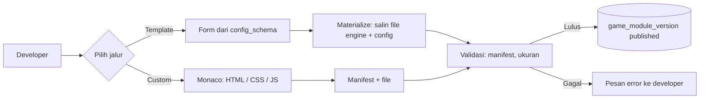
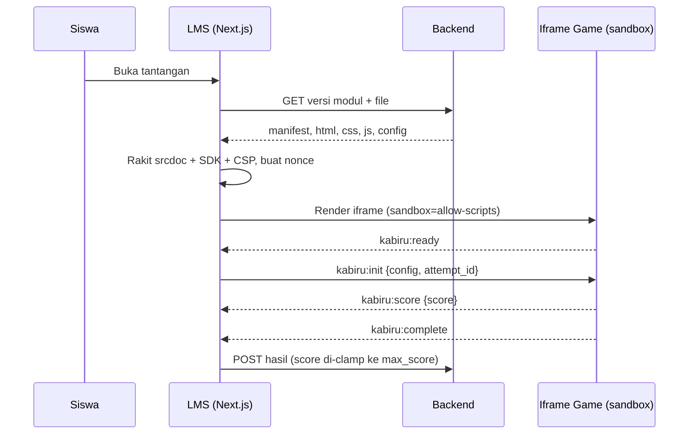

# PRD: Game Module Studio (Template + Custom) untuk LMS KABIRU

| | |
|---|---|
| Penulis | Achmad (NIM 2301508) |
| Versi | 1.0 (7 Nov 2026) |
| Status | Draft untuk dibahas dengan pembimbing |
| Ruang lingkup | Hanya fitur **Game Module** pada Dashboard Management System. Fitur CMS lain (user, kelas, konten) dibahas di PRD terpisah. |

---

## 1. Konsep

### 1.1 Masalah
Penambahan minigame di LMS KABIRU sekarang masih lewat hardcoding di codebase inti. Akibatnya:
- Mahasiswa lain (kelompok Nabil dan Siti) harus mengubah kode inti untuk menambah game.
- Satu kesalahan di kode game bisa merusak seluruh LMS.
- Tidak ada cara mengelola versi game.

### 1.2 Solusi
Developer membuat game lewat dashboard, game disimpan sebagai **modul**, lalu dimainkan siswa di LMS di dalam **iframe sandbox**. Ada dua jalur pembuatan, tetapi hasilnya satu format yang sama:

| | Jalur Template | Jalur Custom |
|---|---|---|
| Cara buat | Pilih 1 dari 8 template, isi form konfigurasi | Tulis HTML, CSS, JS di Monaco Editor |
| Kebebasan | Terbatas pada konfigurasi template | Bebas (dalam batasan sandbox) |
| Target pengguna | **Guru** (tanpa coding) | **Developer/admin** yang butuh game di luar 8 template |
| Hasil | `game_module_version` + `manifest` + file | `game_module_version` + `manifest` + file |

**Keputusan arsitektur utama:** jalur template **tidak** punya mekanisme runtime sendiri. Saat dipublikasikan, template di-*materialize* menjadi file HTML/CSS/JS biasa, lalu disimpan sama seperti modul custom. Dampaknya:
1. Player di LMS hanya punya satu jalur eksekusi, jadi pengujian injeksi dan isolasi cukup satu pipeline.
2. Versi modul bersifat immutable. Template diperbarui pun, game lama tidak berubah.
3. Ini sejalan dengan rumusan skripsi: kebaruannya ada di *injeksi modul tanpa mengubah kode inti*, bukan di template-nya.

### 1.3 Di luar cakupan (jangan dikerjakan)
- Game berbasis block code (Scratch-like): dikerjakan Nabil. Achmad hanya menyediakan kontrak agar modul itu bisa mengirim skor.
- Bank Aset Terpusat: sudah dihapus dari rumusan masalah. Modul cukup satu file HTML, satu CSS, satu JS.
- Dashboard untuk siswa. Guru hanya memakai jalur Template; fitur guru lain (kelas, penilaian, feedback) dibahas di PRD CMS terpisah. Jalur Custom hanya untuk developer/admin.
- Pencegahan kecurangan skor dari sisi klien (lihat 8.2, ini dicatat sebagai batasan).
- Marketplace, rating, atau berbagi modul antar institusi.

### 1.4 Persona

| Persona | Deskripsi | Kebutuhan utama |
|---|---|---|
| **Guru** | Pembuat konten pelajaran, tidak bisa coding | Membuat game dari template lewat form sederhana, tanpa melihat kode |
| **Developer Modul** | Mahasiswa developer (Nabil, Siti, Achmad) | Menambah game custom tanpa menyentuh kode inti |
| **Admin LMS** | Mengelola semua modul dan menautkan ke tantangan | Mengaktifkan, menonaktifkan, rollback versi |
| **Siswa** | Memainkan game di LMS | Game jalan lancar, skor tercatat |

---

## 2. User Stories dan Prioritas (MVP)

**P0 = wajib untuk demo dan pengujian skripsi. P1 = dikerjakan jika waktu cukup. P2 = nice-to-have, cukup ditulis di saran pengembangan.**

| ID | User Story | Prioritas |
|---|---|---|
| US-01 | Sebagai **guru**, saya memilih template game dan mengisi konfigurasi lewat form agar game untuk materi saya jadi tanpa coding. | P0 |
| US-11 | Sebagai guru, saya hanya melihat dan mengubah modul buatan saya sendiri. | P0 |
| US-12 | Sebagai guru, saya melihat preview game sebelum publish agar tahu tampilannya di siswa. | P0 |
| US-02 | Sebagai **developer**, saya menulis HTML/CSS/JS di Monaco Editor agar bisa membuat game di luar template. | P0 |
| US-03 | Sebagai developer, saya melihat preview game (di sandbox yang sama dengan LMS) sebelum publish. | P0 |
| US-04 | Sebagai developer, saya mempublikasikan versi modul agar bisa dipakai di tantangan. | P0 |
| US-05 | Sebagai admin, saya menautkan versi modul ke tantangan (`challenge`) agar muncul di halaman siswa. | P0 |
| US-06 | Sebagai siswa, saya memainkan game dan skor saya tersimpan. | P0 |
| US-07 | Sebagai admin, saya rollback ke versi sebelumnya jika versi baru bermasalah. | P1 |
| US-08 | Sebagai developer, saya menduplikasi modul yang ada sebagai titik awal modul baru. | P1 |
| US-09 | Sebagai developer, saya mengubah modul template menjadi custom (convert) agar bisa dimodifikasi bebas. | P2 |
| US-10 | Sebagai developer, saya melihat log error dari game yang dimainkan siswa. | P2 |

---

## 3. Functional Requirements

### 3.1 Pembuatan modul
| ID | Requirement | Acceptance criteria |
|---|---|---|
| FR-01 | Sistem menyediakan 8 template: Drag & Drop, Pattern Painter, Maze Runner, Sorting, Code Debugger, Fill in the Blank, Multiple Choice, Checkbox. | Daftar template tampil, tiap template punya form dari `config_schema`. |
| FR-02 | Form konfigurasi dibuat otomatis dari JSON Schema template, dan divalidasi di klien dan server. | Input tidak valid ditolak dengan pesan per kolom. |
| FR-03 | Editor custom memakai Monaco dengan 3 tab: `index.html`, `style.css`, `script.js`. | Ketiganya bisa diedit dan disimpan sebagai draft. |
| FR-04 | Modul custom boleh punya `config_schema` opsional agar bisa memakai form konfigurasi yang sama. | Manifest dengan `config_schema` menampilkan form di dashboard. |
| FR-05 | Total ukuran file satu versi dibatasi (usulan: 500 KB). | Upload lebih besar ditolak. |

### 3.1b Hak akses
| ID | Requirement | Acceptance criteria |
|---|---|---|
| FR-16 | Jalur Template bisa dipakai role `guru`, `developer`, `admin`. Jalur Custom hanya `developer` dan `admin`. | Guru yang memanggil endpoint custom mendapat 403. |
| FR-17 | Guru hanya bisa melihat, mengubah, dan mempublikasikan modul dengan `created_by` = dirinya. Admin bisa semua. | Guru A tidak bisa membuka modul guru B (403). |
| FR-18 | UI guru tidak menampilkan kode, manifest, atau JSON Schema mentah. Hanya form dengan label bahasa Indonesia. | Tidak ada tab editor kode di tampilan guru. |
| FR-19 | Isi form guru divalidasi di server memakai `config_schema` (tipe, panjang maksimum, jumlah item). | Konfigurasi di luar batas ditolak. |

### 3.2 Versi dan publikasi
| ID | Requirement | Acceptance criteria |
|---|---|---|
| FR-06 | Setiap simpan publish membuat `game_module_version` baru dengan status `draft` → `published` → `archived`. | Versi `published` tidak bisa diubah. |
| FR-07 | Publish menjalankan validasi manifest dan batas ukuran. | Gagal validasi = tidak ada versi `published`. |
| FR-08 | Template di-*materialize* menjadi file saat publish (snapshot). | File template tersimpan di `game_module_file`. |

### 3.3 Eksekusi di LMS
| ID | Requirement | Acceptance criteria |
|---|---|---|
| FR-09 | Player memuat modul ke `<iframe sandbox="allow-scripts">` (tanpa `allow-same-origin`). | Lihat TC-S02. |
| FR-10 | Host menyuntikkan SDK kecil (`Kabiru.*`) dan mengirim pesan `kabiru:init`. | Game menerima `config`, `attempt_id`, `nonce`. |
| FR-11 | Komunikasi hanya lewat `postMessage` dengan format di bagian 5. | Pesan tidak valid diabaikan. |
| FR-12 | Skor dibatasi `max_score` dari manifest saat disimpan. | Skor di atas maksimum tersimpan sebagai `max_score`. |
| FR-13 | Error di dalam game tidak membuat halaman LMS crash. | Lihat TC-S03. |

### 3.4 Penautan ke tantangan
| ID | Requirement | Acceptance criteria |
|---|---|---|
| FR-14 | `challenge.game_module_version_id` menunjuk ke versi, bukan ke modul. | Tantangan tetap memakai versi yang sama walau modul punya versi baru. |
| FR-15 | Admin bisa memilih versi `published` saja. | Versi `draft` tidak muncul di pilihan. |

### 3.5 Non-functional
| ID | Requirement | Ukuran |
|---|---|---|
| NFR-01 | Modularitas: menambah game baru tidak mengubah file inti. | Jumlah file inti yang berubah = 0 (sesuai Modularity Index di Bab 3) |
| NFR-02 | Keamanan: kode game tidak bisa mengakses DOM, cookie, atau storage LMS. | Semua TC-S lulus |
| NFR-03 | Usability dashboard. | Skor SUS (target dan pembanding mengikuti Bab 3) |
| NFR-04 | Waktu muat game dari klik sampai `kabiru:ready`. | Usulan: < 2 detik pada jaringan kampus (tetapkan setelah uji awal) |

---

## 4. Arsitektur

### 4.1 Alur pembuatan dan publikasi



### 4.2 Alur eksekusi di LMS



### 4.3 Monolith atau microservices
**Monolith modular.** Alasannya: tim kecil, waktu 2 bulan, dan yang diteliti adalah *modularitas modul game*, bukan pemisahan layanan backend. Memisahkan backend jadi microservices hanya menambah risiko tanpa menambah nilai untuk skripsi. Gunakan folder terpisah per domain (`game-module`, `challenge`, `submission`) agar tetap rapi.

### 4.4 Atribut iframe

```html
<iframe
  sandbox="allow-scripts"
  srcdoc="..."            <!-- dirakit host: CSP + SDK + html + css + js -->
  referrerpolicy="no-referrer"
  loading="lazy"
  title="Game: {{nama}}"
></iframe>
```

CSP di dalam `srcdoc` (usulan awal, sesuaikan saat pengujian):

```
default-src 'none'; script-src 'unsafe-inline'; style-src 'unsafe-inline'; img-src data: blob:; connect-src 'none'
```

**Catatan penting untuk Bab 3 dan lampiran uji (TC-S05):** karena `allow-same-origin` tidak dipakai, iframe punya origin `null`, sehingga `event.origin` bernilai string `"null"` dan **tidak bisa dipakai untuk membedakan pengirim**. Validasi pengirim harus memakai kombinasi `event.source === iframe.contentWindow` dan `nonce` per sesi. Jangan tulis "validasi origin" saja di lampiran, nanti tidak sesuai dengan implementasi.

---

## 5. Kontrak Modul

### 5.1 Manifest

```json
{
  "schema_version": 1,
  "name": "Sorting Angka",
  "slug": "sorting-angka",
  "version": "1.0.0",
  "source": "template",
  "template_id": "sorting",
  "entry": { "html": "index.html", "css": "style.css", "js": "script.js" },
  "max_score": 100,
  "config_schema": { "type": "object", "properties": {} }
}
```

Aturan: jika `source = "template"` maka `template_id` wajib ada. Jika `source = "custom"` maka `template_id` harus kosong.

### 5.2 Pesan postMessage

| Arah | `type` | Isi | Keterangan |
|---|---|---|---|
| Host → Game | `kabiru:init` | `config`, `attempt_id`, `nonce`, `max_score` | Dikirim setelah `kabiru:ready` |
| Game → Host | `kabiru:ready` | `nonce` | Game siap menerima init |
| Game → Host | `kabiru:score` | `nonce`, `score` | Boleh dikirim berkali-kali |
| Game → Host | `kabiru:complete` | `nonce` | Game selesai |
| Game → Host | `kabiru:error` | `nonce`, `message` | Maksimal 500 karakter |

Catatan: host mengirim ke `iframe.contentWindow` dengan `targetOrigin "*"`. Ini tidak masalah karena pesan hanya sampai ke window iframe itu (origin `null` tidak bisa dijadikan target spesifik).

### 5.3 SDK untuk developer (disuntikkan host)

```js
Kabiru.onInit(({ config, maxScore }) => { /* mulai game */ });
Kabiru.submitScore(80);
Kabiru.complete();
```

SDK ini yang membuat kelompok Nabil dan Siti cukup mengikuti satu aturan: panggil tiga fungsi di atas. Tanpa SDK, mereka harus menulis `postMessage` sendiri dan rawan salah format.

### 5.4 Konfigurasi 8 template (usulan, cocokkan dengan implementasi yang sudah ada)

| Template | Isi konfigurasi utama | Cara skor dihitung |
|---|---|---|
| Drag & Drop | daftar item, daftar target, pasangan benar | % pasangan benar |
| Pattern Painter | ukuran grid, palet warna, pola target | % sel yang cocok |
| Maze Runner | peta grid, titik awal, titik tujuan, batas langkah | sampai tujuan = penuh, dikurangi per langkah berlebih |
| Sorting | daftar item, urutan (naik/turun) | benar/salah atau % posisi benar |
| Code Debugger | kode awal, bahasa, baris yang salah, jawaban benar | % bug yang diperbaiki |
| Fill in the Blank | teks dengan penanda kosong, kunci jawaban, case-sensitive atau tidak | % isian benar |
| Multiple Choice | pertanyaan, opsi, indeks jawaban benar, penjelasan | benar = `max_score` |
| Checkbox | pertanyaan, opsi, indeks jawaban benar, skor parsial atau tidak | % pilihan benar |

> Pertanyaan untuk Anda: apakah Code Debugger Anda menjalankan kode siswa? Kalau ya, itu eksekusi kode di dalam sandbox yang sudah berlapis (kode game + kode siswa). Pastikan ini dicatat di batasan, atau ubah jadi pencocokan teks.

---

## 6. Skema Database

Dasar: ERD revisi v1 (`game_module`, `game_module_version`, `game_module_file`, `asset`, `challenge`). Di bawah hanya bagian yang **ditambah atau diubah**. Cek ulang terhadap ERD "KABIRU X KODA" sebelum dijalankan, karena saya tidak melihat DDL aslinya.

```sql
CREATE TYPE module_source  AS ENUM ('template', 'custom');
CREATE TYPE version_status AS ENUM ('draft', 'published', 'archived');

-- Katalog 8 template
CREATE TABLE game_template (
  id             TEXT PRIMARY KEY,               -- 'multiple_choice', 'sorting', ...
  name           TEXT NOT NULL,
  description    TEXT,
  config_schema  JSONB NOT NULL,                 -- JSON Schema untuk form
  default_config JSONB NOT NULL DEFAULT '{}',
  engine_files   JSONB NOT NULL,                 -- {html, css, js} sumber yang disalin saat materialize
  is_active      BOOLEAN NOT NULL DEFAULT TRUE
);

ALTER TABLE game_module
  ADD COLUMN source      module_source NOT NULL,
  ADD COLUMN template_id TEXT REFERENCES game_template(id),
  ADD COLUMN created_by  UUID NOT NULL REFERENCES "user"(id),  -- dasar FR-17
  ADD CONSTRAINT chk_template CHECK (
    (source = 'template' AND template_id IS NOT NULL) OR
    (source = 'custom'   AND template_id IS NULL)
  );

ALTER TABLE game_module_version
  ADD COLUMN status        version_status NOT NULL DEFAULT 'draft',
  ADD COLUMN config        JSONB NOT NULL DEFAULT '{}',   -- isian form template / config custom
  ADD COLUMN published_at  TIMESTAMPTZ,
  ADD COLUMN published_by  UUID REFERENCES "user"(id);

-- Satu versi unik per modul
CREATE UNIQUE INDEX uq_module_version
  ON game_module_version (game_module_id, version);

-- Hanya file entrypoint yang boleh satu per jenis
CREATE UNIQUE INDEX uq_entry_file
  ON game_module_file (game_module_version_id, relative_path);
```

Catatan desain:
- `challenge.game_module_version_id` tetap menunjuk ke versi, jadi tantangan lama tidak ikut berubah saat modul punya versi baru.
- Skor siswa sebaiknya memakai tabel `SUBMISSION` dan `SCORE` yang sudah ada dari Koda agar merge lebih mudah. `payload` (jsonb) dipakai untuk detail jawaban.
- Dua tipe data baru (`module_source`, `version_status`) harus masuk dokumentasi 13 tipe enum/jsonb yang diminta tim.

---

## 7. Contoh Kode (modular dan bisa diuji)

### 7.1 Validasi manifest (dipakai di dashboard dan backend)

```ts
// packages/game-module/manifest.ts
import { z } from "zod";

export const ManifestSchema = z
  .object({
    schema_version: z.literal(1),
    name: z.string().min(3).max(80),
    slug: z.string().regex(/^[a-z0-9-]+$/),
    version: z.string().regex(/^\d+\.\d+\.\d+$/),
    source: z.enum(["template", "custom"]),
    template_id: z.string().nullable().optional(),
    entry: z.object({
      html: z.literal("index.html"),
      css: z.literal("style.css"),
      js: z.literal("script.js"),
    }),
    max_score: z.number().int().positive().max(1000),
    config_schema: z.record(z.unknown()).optional(),
  })
  .refine((m) => (m.source === "template") === Boolean(m.template_id), {
    message: "template_id wajib untuk source=template dan harus kosong untuk custom",
    path: ["template_id"],
  });
```

### 7.2 Jembatan postMessage di sisi host

```ts
// packages/game-module/bridge.ts
import { z } from "zod";

const Base = { nonce: z.string().min(16) };
const ChildMessage = z.discriminatedUnion("type", [
  z.object({ type: z.literal("kabiru:ready"), ...Base }),
  z.object({ type: z.literal("kabiru:score"), ...Base, score: z.number().finite().min(0) }),
  z.object({ type: z.literal("kabiru:complete"), ...Base }),
  z.object({ type: z.literal("kabiru:error"), ...Base, message: z.string().max(500) }),
]);

type Opts = {
  frame: HTMLIFrameElement;
  nonce: string;
  maxScore: number;
  onReady: () => void;
  onScore: (score: number) => void;
  onComplete: () => void;
  onError: (message: string) => void;
};

export function createBridge(opts: Opts) {
  const handler = (e: MessageEvent) => {
    // origin iframe sandbox = "null", jadi cek pengirim lewat source + nonce
    if (e.source !== opts.frame.contentWindow) return;
    const parsed = ChildMessage.safeParse(e.data);
    if (!parsed.success || parsed.data.nonce !== opts.nonce) return;

    const msg = parsed.data;
    switch (msg.type) {
      case "kabiru:ready":    opts.onReady(); break;
      case "kabiru:score":    opts.onScore(Math.min(msg.score, opts.maxScore)); break;
      case "kabiru:complete": opts.onComplete(); break;
      case "kabiru:error":    opts.onError(msg.message); break;
    }
  };
  window.addEventListener("message", handler);
  return () => window.removeEventListener("message", handler);
}
```

### 7.3 Unit test (Vitest + jsdom)

```ts
// packages/game-module/bridge.test.ts
import { describe, it, expect, vi, beforeEach } from "vitest";
import { createBridge } from "./bridge";
import { ManifestSchema } from "./manifest";

const NONCE = "a".repeat(32);

function setup(contentWindow: unknown = window) {
  const cb = { onReady: vi.fn(), onScore: vi.fn(), onComplete: vi.fn(), onError: vi.fn() };
  const frame = { contentWindow } as unknown as HTMLIFrameElement;
  const dispose = createBridge({ frame, nonce: NONCE, maxScore: 100, ...cb });
  return { cb, dispose };
}

const send = (data: unknown, source: MessageEventSource | null = window) =>
  window.dispatchEvent(new MessageEvent("message", { data, source }));

describe("createBridge", () => {
  beforeEach(() => vi.clearAllMocks());

  it("meneruskan skor valid", () => {
    const { cb, dispose } = setup();
    send({ type: "kabiru:score", nonce: NONCE, score: 80 });
    expect(cb.onScore).toHaveBeenCalledWith(80);
    dispose();
  });

  it("memotong skor ke max_score", () => {
    const { cb, dispose } = setup();
    send({ type: "kabiru:score", nonce: NONCE, score: 9999 });
    expect(cb.onScore).toHaveBeenCalledWith(100);
    dispose();
  });

  it("mengabaikan nonce yang salah", () => {
    const { cb, dispose } = setup();
    send({ type: "kabiru:score", nonce: "x".repeat(32), score: 50 });
    expect(cb.onScore).not.toHaveBeenCalled();
    dispose();
  });

  it("mengabaikan pesan dari window selain iframe", () => {
    const { cb, dispose } = setup({}); // contentWindow bukan window ini
    send({ type: "kabiru:score", nonce: NONCE, score: 50 });
    expect(cb.onScore).not.toHaveBeenCalled();
    dispose();
  });

  it("mengabaikan format yang salah (skor negatif / bukan angka)", () => {
    const { cb, dispose } = setup();
    send({ type: "kabiru:score", nonce: NONCE, score: -5 });
    send({ type: "kabiru:score", nonce: NONCE, score: "100" });
    expect(cb.onScore).not.toHaveBeenCalled();
    dispose();
  });
});

describe("ManifestSchema", () => {
  const base = {
    schema_version: 1, name: "Quiz A", slug: "quiz-a", version: "1.0.0",
    entry: { html: "index.html", css: "style.css", js: "script.js" }, max_score: 100,
  };

  it("menerima template dengan template_id", () => {
    expect(ManifestSchema.safeParse({ ...base, source: "template", template_id: "sorting" }).success).toBe(true);
  });
  it("menolak template tanpa template_id", () => {
    expect(ManifestSchema.safeParse({ ...base, source: "template" }).success).toBe(false);
  });
  it("menolak custom yang membawa template_id", () => {
    expect(ManifestSchema.safeParse({ ...base, source: "custom", template_id: "sorting" }).success).toBe(false);
  });
});
```

### 7.4 Integration test yang perlu ada (ringkas)
1. Publish modul template → `game_module_file` terisi tiga file dan versi berstatus `published`.
2. Publish dua kali dengan versi sama → ditolak (unique index).
3. Ubah versi `published` → ditolak.
4. Tautkan tantangan ke versi `draft` → ditolak.
5. Kirim skor di atas `max_score` ke endpoint hasil → tersimpan sebagai `max_score`.

---

## 8. Keamanan dan Batasan

### 8.1 Ancaman dan mitigasi (OWASP)

| Ancaman | Mitigasi | Test case |
|---|---|---|
| Game mengakses `window.parent.document` | `sandbox` tanpa `allow-same-origin` | TC-S02 |
| XSS lewat teks yang ditampilkan dashboard (mis. nama modul, pesan error) | Tampilkan sebagai `textContent`, jangan `innerHTML` | TC-S04 |
| Pesan palsu ke host | `event.source` + `nonce` + validasi skema | TC-S05 (ubah deskripsinya, lihat 4.4) |
| Game mengirim request keluar | CSP `connect-src 'none'` | tambahkan test case baru |
| Game menimpa skor melalui API langsung | Endpoint skor wajib login, cek kepemilikan `attempt_id` | integration test no. 5 |
| Upload file terlalu besar | Batas ukuran di server | FR-05 |
| Teks isian guru berisi HTML/script | Engine template merender isian dengan `textContent`, bukan `innerHTML`; batas panjang di server (FR-19) | TC baru: isi `` di soal, pastikan tampil sebagai teks |
| Guru memanggil fitur custom | Cek role di server untuk setiap endpoint, bukan hanya menyembunyikan menu | integration test: guru → endpoint custom = 403 |
| Guru membuka atau mengubah modul guru lain | Filter `created_by` di setiap query | integration test: guru A → modul guru B = 403 |

### 8.2 Batasan yang harus ditulis di Bab 1 (agar jujur dan aman saat sidang)
1. Skor dihitung di sisi klien. Server hanya membatasi sampai `max_score`, tidak memverifikasi permainan. Pencegahan curang di luar cakupan.
2. Sandbox melindungi LMS dari **kesalahan dan akses tidak sah**, bukan dari game yang sengaja memakai CPU berlebihan (loop tak berhingga) di dalam iframe-nya sendiri.
3. Pengguna dashboard adalah developer yang dipercaya sebagian. Sandbox adalah pertahanan berlapis, bukan satu-satunya kontrol.
4. Modul dibatasi satu HTML, satu CSS, satu JS.

---

## 9. Pengukuran (selaras dengan Bab 3)

| Tujuan penelitian | Yang diukur | Instrumen |
|---|---|---|
| Injeksi modul tanpa hardcoding | Functional Pass Rate untuk **8 template + minimal 1 modul custom**; Modularity Index | Equivalence Partitioning (perlu diperluas ke 8 modul, sesuai catatan di lampiran) |
| Isolasi keamanan iframe | Hasil Fault Injection (TC-S02, S04, S05, dan tambahan) | Lampiran 1 |
| Usability dashboard | Skor SUS dari **guru** (jalur template) dan developer/admin (jalur custom) | Kuesioner SUS |

Catatan bimbingan: Bank Aset sudah dihapus, jadi kolom "performa Bank Aset (n=10)" **harus dihapus** dari Bab 3, GQM, dan lampiran agar konsisten dengan rumusan masalah.

---

## 10. Rencana Pengerjaan (usulan, sisa waktu sekitar 3 minggu dari 7 Nov)

| Minggu | Target P0 |
|---|---|
| 1 | Skema DB, manifest, validator, CRUD modul dan versi, editor Monaco + preview |
| 2 | Player iframe + SDK + bridge, materialize template (mulai dari Multiple Choice, Checkbox, Fill in the Blank karena paling sederhana), penautan ke tantangan |
| 3 | Sisa template (Drag & Drop, Sorting, Pattern Painter, Maze Runner, Code Debugger), pengujian TC-S, unit dan integration test, uji SUS |

Jika waktu mepet, pangkas dengan urutan: Code Debugger → Maze Runner → Pattern Painter. Skripsi tidak gugur jika ada template yang belum selesai, **asalkan** daftar 8 modul di Bab 3 diubah menyesuaikan.

---

## 11. Pertanyaan Terbuka (perlu keputusan sebelum coding)

1. **Stack backend** apa yang dipakai? PRD ini sengaja netral. Kode contoh memakai TypeScript karena dipakai bersama di Next.js dan backend.
2. Apakah tabel `SUBMISSION` dan `SCORE` dari Koda cukup untuk menyimpan hasil game, atau perlu `game_attempt` tersendiri?
3. Apakah game Nabil dan Siti sudah punya format file sendiri? Jika sudah, sesuaikan SDK agar tidak memaksa mereka menulis ulang.
4. Apakah Code Debugger menjalankan kode siswa, atau hanya mencocokkan teks?
5. Apakah template perlu bisa diedit setelah publish (lewat convert ke custom, US-09), atau cukup dibuat ulang?
6. **Konfirmasi ke pembimbing:** menjadikan guru sebagai pengguna jalur template mengubah populasi dan sampel di Bab 3 (sekarang administrator/developer dan siswa). Pastikan disetujui sebelum Bab 3 diubah.
7. Apakah modul buatan guru langsung tayang saat publish, atau perlu persetujuan admin dulu? Untuk MVP saya sarankan langsung tayang dan hanya bisa dipakai di kelas milik guru itu sendiri.